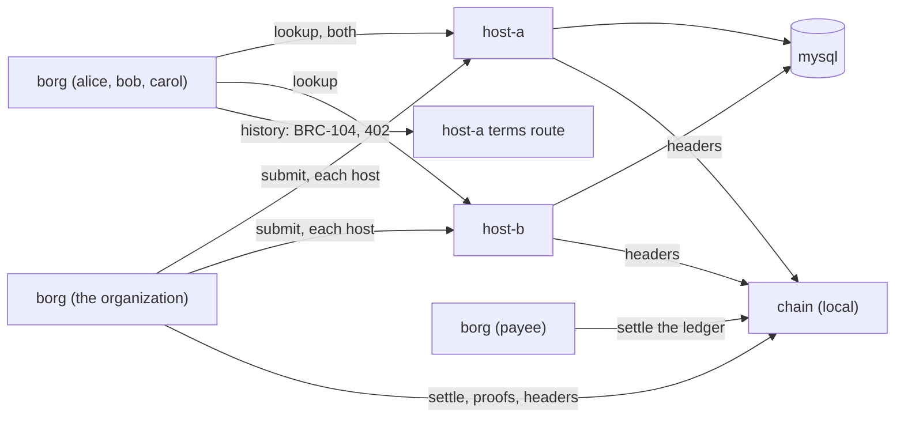

# Quickstart

Two ways in. **On mainnet or testnet** you fund borg with a small payment
from your own wallet and use overlay hosts that carry the borg module. **In
the local development sandbox** a private regtest chain stands in for the
network, so no coin is needed; it is for trying borg and for development,
not for real use.

## On mainnet or testnet

You need:

- BSV in a wallet you control (mainnet), or testnet coin (testnet). About
  20,000 sat covers an organization, a group and a few dozen changes
  ([limits.md](docs/limits.md#what-it-costs)).
- One or more overlay hosts that carry your hall: the `borg-host` image, or
  the borg module on any reference overlay host ([host.md](docs/host.md)).
- A node's asset API (`asset`): a Teranode node you run or may use. It
  serves proofs, the tip and the spent-output view.
- A broadcast service (`settle`): `arcade:<url>` for any ARC-compatible
  API, `rpc:<url>` for a node, or `tcp:<host:port>` for an ingress.
- A header source: `woc:main` or `woc:test` (public WhatsOnChain), or your
  own chaintracks service or overlay bridge.

```console
$ mkdir -p ~/.borg && cat > ~/.borg/config <<'CONF'
network    = main
header_url = woc:main
asset      = https://asset.example.com
settle     = arcade:https://arc.example.com
mode       = unicast
hosts      = https://host-a.example.com,https://host-b.example.com
CONF
$ borg init
created /home/you/.borg
identity     02c6...
fund address 1Ab... (main)
```

Send about 20,000 sat from your own wallet to the fund address `init`
printed. When the payment has one confirmation, import it by its txid:

```console
$ borg fund -txid <txid>
$ borg hall new example              # give the printed BORG_HALLS line to your hosts
$ borg -hall example_<suffix> doctor # every endpoint answers?
$ borg -hall example_<suffix> org create 'Example' -member <alice key> -member <bob key>
$ borg -hall example_<suffix> group create engineering -member <alice key> -member <bob key>
```

Each member runs `borg init` (no coin needed), sends you the `identity` line,
and with `org`, `hall`, `hosts`, `header_url` and `asset` in their config
reads the group's key:

```console
$ borg open engineering
```

For testnet use `network = test` and `header_url = woc:test` with a
testnet node and broadcast service; the fund address then starts with `m`
or `n`. Every command after that is the same. The whole walk, with removal,
revocation, a second home and the priced question, is
[docs/examples.md](docs/examples.md).

## Local development sandbox (no coin needed, a private regtest chain)

In about five minutes, on one machine: run two overlay hosts that carry a
hall, create an organization with three members in unicast mode, give them
a group whose key each of them opens, remove one member and watch the key
change under them, revoke a grant by sweep, pay a host's 402 for the
priced history question, make the removal a revoked member is owed, and
check that the two hosts hold the same. A local regtest chain stands in for
the network and mines coinbase to each home (coinbase: only on a regtest
chain you run, for development and tests); nothing it mines is money.

You need [Docker](https://docs.docker.com/get-docker/) with Compose, and
this repository. Build the three images first (`make docker-build` and
`make docker-build-host REFERENCE_HOST_IMAGE=<the reference overlay host
image>`), or set `BORG_IMAGE`, `BORG_HOST_IMAGE` and `DEVCHAIN_IMAGE` to
published ones.



### 1. Start the local chain

```console
$ cd deploy/quickstart
$ docker compose up -d chain
$ as() { who=$1; shift; docker compose run --rm -T -e BORG_HOME=/home/nonroot/.borg/$who borg "$@"; }
```

`chain` is a stand-in for the network: it serves a node's API, mines every
transaction it is sent at once, and is the header source the hosts and
`borg` check proofs against. Nothing it mines is money. The `borg` service
is configured for it and for the two hosts, in unicast mode (the settings
are in `compose.yaml`). `as org ...` runs it with the organization's home;
each identity has its own.

The images are `ghcr.io/lightwebinc/borg`, `borg-host` and
`borg-devchain`, tag `latest` unless the variables above name others.

### 2. An organization, three members, a hall, the payee key

```console
$ as org init | tee org.txt && as org fund
$ for m in alice bob carol; do as $m init | tee $m.txt; done
$ as bob fund
$ key() { sed -n 's/^identity *//p' $1; }
$ ORG=$(key org.txt) ALICE=$(key alice.txt) BOB=$(key bob.txt) CAROL=$(key carol.txt)
$ as payee init
$ as org hall new example | tee hall.txt
hall  example_qzxkvbmwtr
topic tm_borg_example_qzxkvbmwtr
host  BORG_HALLS=example_qzxkvbmwtr
$ sed -n 's/^host *//p' hall.txt > .env
$ echo "BORG_ORG=$ORG" >> .env
$ as payee payee key -out - >> .env
```

`init` made an identity key for each. The organization is an identity key:
the org home's key will sign every grant and every change. `fund` (no
`-txid`) mined 101 blocks of coinbase to a fund address on the sandbox
chain, so one block's coin is mature (coinbase: only on a regtest chain you
run, for development and tests; on mainnet or testnet you import a payment
with `fund -txid` instead); the members
need none (bob is funded only to pay for the priced question later). The
hall's name gets a random suffix, so nobody else's hall shares its topic,
and the `host` line is what a host needs to carry it. `.env` hands the
hall to the hosts and to the `borg` service, the organization's key to the
members, and the payee key to host-a.

### 3. Start two hosts

```console
$ docker compose up -d
$ as org doctor
...
mode        unicast: every object to each of 2 host(s); a carrier published once 2 take it (quorum all), a token or sweep once all do
host        http://host-a:8080 answering
host        http://host-b:8080 answering
history     http://host-a:8090 serves terms (2 priced class(es))
```

The first start takes a few seconds while MySQL initializes; run `doctor`
again until both hosts answer.

### 4. The organization and a group

```console
$ as org org create 'Example Organization' -member $ALICE -member $BOB -member $CAROL
org     02c6…9a1e
hall    example_qzxkvbmwtr
name    Example Organization
seq     0 8b0e…12fa
grant   1c7d…0b3e 03a1…77c2 member
...
$ as org group create engineering -member $ALICE -member $BOB -member $CAROL | tee group.txt
group   5a0c4d…9d12
name    engineering
seq     0 3f9a…c410 epoch 0, 3 member(s), wrapped to each
$ GROUP=$(sed -n 's/^group *//p' group.txt)
```

`org create` minted the organization's funding trees, signed a BRC-52
membership grant to each member and sent it to both hosts, then minted the
organization's first token, whose record admits the three grants to the
roll; once it was mined it went to both hosts. `group create` drew a group
id and a random epoch key, committed to the key in the group's first
token, and once that was mined wrapped the key to each member: one record
on the plane per batch of members, each entry readable by one member's key.

### 5. Every member opens the key

```console
$ as alice open engineering
group   5a0c4d…9d12 engineering
latest  seq 0 3f9a…c410 epoch 0, 3 member(s)
epoch   0 OPENED from http://host-a:8080 (commitment 2848…)
```

`open` read the group's chain from both hosts, checked every token against
the headers, found the wrap addressed to alice, decrypted it with her
wallet, and checked the key against the commitment the token made before
anyone held it. The key is kept in alice's home. Bob and carol do the
same.

### 6. Remove bob

```console
$ as org org remove $BOB -group engineering
group   5a0c4d…9d12 seq 1 af36…6acd epoch 1 (a new epoch: a fresh key, wrapped to every member)
$ as alice open engineering
epoch   0 held (commitment 2848…)
epoch   1 OPENED from http://host-a:8080 (commitment 0827…)
$ as bob open engineering
epoch   0 held (commitment 2848…)
epoch   1 CANNOT OPEN: removed at seq 1 (af36…6acd), which began epoch 1; no wrap of a later epoch names this key
$ echo $?
1
```

A removal must begin a new epoch: every host refuses a token that removes
anyone without one. The new key was sampled fresh and wrapped only to
alice and carol. Bob keeps what he could read before, and nothing after.

### 7. The roll, and a revocation by sweep

```console
$ as alice roll
host http://host-a:8080: 3 grant(s), the root of seq 0 reproduced
host http://host-b:8080: 3 grant(s), the root of seq 0 reproduced
grant   … role member scope member until …: CURRENT
...
$ as org grant revoke $CAROL -by sweep
sweep   74ba…8a21 spends 1 revocation outpoint(s) of 80c5…c566, mined at height 909
$ as carol member $CAROL
grant   … : not current, revoked: its revocation outpoint is spent by 74ba…8a21
```

`roll` asked both hosts for every grant, verified each, and checked that
what each host answered hashes to the root the organization's token
committed to: a host cannot leave a grant out unseen. A grant's revocation
outpoint is the output that funded it; the sweep spent it, so every BRC-52
verifier now treats the grant as revoked and both hosts retract it. Carol
is now rotation debt in the group: the group's next transition removes her
first (`borg epoch rotate engineering` does it now). `grant revoke` without
`-by` also revokes in the roll.

### 8. The priced question, and the payee

```console
$ as bob terms
service ls_borg, terms 1
history        5 sat a question
history-after  5 sat a question
$ as bob history -chain $GROUP
paid 5 sat to 0268…a450 in 9ade…7f2e, recorded by the host for its payee to settle
seq 0  f635…33e6  height 906  epoch 0  +3 -0  3 member(s)
seq 1  af36…6acd  height 908  epoch 1  +0 -1  2 member(s)
$ as payee payee settle /var/lib/borg-a/payments.jsonl
1 payment(s) settled, 5 sat; 0 settled before; 0 not settled; 0 refused (0 before); pool 1 output(s), 5 sat
```

`history` asked host-a's terms route over BRC-104; host-a answered 402 with
its price, `borg` paid it from bob's pool (BRC-105) and asked again. The
free classes give the same tokens one at a time; the priced class sells
the bulk walk. `payee settle` took the payment into the payee's wallet:
checked, broadcast, mined, pooled.

### 9. The removal owed, and do the hosts agree?

```console
$ as org org due
due     group 5a0c4d…9d12 engineering: 02f1…3c5a: it holds no current grant (revoked, swept, or never in the roll)
$ as org org due -apply
group   5a0c4d…9d12 seq 2 61d0…e7b3 epoch 2 (a new epoch: a fresh key, wrapped to every member)
removed 02f1…3c5a: rotation debt (no current grant)
applied 1 group(s) with removals due
$ as alice fill
filled  0 object(s) at 0 host(s)
```

Carol's grant is revoked, so the organization owes her a removal from the
group: `org due` lists it (and exits 3), and `-apply` makes it, with a new
epoch that only alice opens. It lists a grant that is about to expire the
same way, before it does; run from a timer, `org due -apply` removes each
member when their grant lapses.

`fill` compared what the two hosts answer (the organization's chain, the
roll's grants, the group's chain and its wraps) and found nothing to copy.
Had host-b been down while the organization published, it would lack
tokens and wraps, every reading command would say `DISAGREES`, and `fill`
would replay each one to it from host-a's answers, verified first: anyone
can run it, and it needs no coin.

### 10. Clean up

```console
$ docker compose --profile cli down -v
```

### Next

[docs/examples.md](docs/examples.md) runs the same on mainnet or testnet;
[docs/user-guide.md](docs/user-guide.md) explains the concepts and the
day-to-day use; [docs/configuration.md](docs/configuration.md) every setting;
[docs/limits.md](docs/limits.md) every default and cap.
