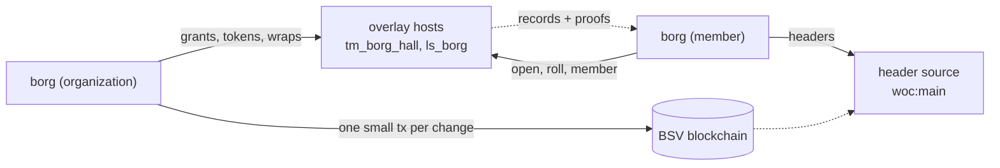

# borg

[](https://github.com/lightwebinc/borg/actions/workflows/ci.yml)
[](https://github.com/lightwebinc/borg/releases)
[](https://pkg.go.dev/github.com/lightwebinc/borg)
[](go.mod)
[](LICENSE)

> [!WARNING]
> **Experimental software.** borg is part of [bstack](https://github.com/lightwebinc/bstack),
> the applications and patterns built on [BSV Layered Multicast](https://github.com/lightwebinc/bsv-multicast).
> It is published to be built on and improved. Interfaces, formats and behavior may change
> rapidly between releases; pin an exact version.

Organizations and groups on Bitcoin, replicated by overlay hosts. An
organization issues each member a certificate; a group's membership is a
chain of mined tokens; and every removal from a group begins a new epoch
whose key the removed member never receives.

## How it works



- **Membership is a certificate.** Each member holds a BRC-52 certificate
  issued by the organization's key, with a role, a scope and an expiry. Its
  revocation outpoint is the output that funds it, so one mined spend
  revokes it for every verifier and retracts it from every host.
- **Changes are ordered by the chain.** The roll and each group are chains of
  mined tokens, one per change. Two changes made at once spend the same
  output and only one is ever mined: no coordinator, no merge.
- **Removal is a rekey, checked by every host.** A transition that removes
  anyone must begin a new epoch with a new key commitment, or no host admits
  it. The new key is random, committed before anyone holds it (BRC-369), and
  wrapped only to the members who remain.
- **Hosts are replicas, not authorities.** A host can withhold; it cannot
  forge. Roots over the roll and over each group's members make withholding
  visible, and `borg fill` repairs a host that missed something.

## Install

```console
$ go install github.com/lightwebinc/borg/cmd/borg@latest
```

Or download a static binary for Linux or macOS (amd64, arm64) from
[Releases](https://github.com/lightwebinc/borg/releases), or run the image:

```console
$ docker run --rm -v borg-home:/home/nonroot/.borg ghcr.io/lightwebinc/borg -version
```

## Example: an organization on mainnet

You need BSV in a wallet you control and overlay hosts that carry the borg
module ([host.md](docs/host.md)). No node is needed: headers, transactions,
proofs and spends come from WhatsOnChain and broadcasts go through
GorillaPool's public arcade by default, every proof checked against the
headers; a node of your own is the better option where you have one.
Nothing is mined for you: the organization is funded with a payment you
send.

```console
$ borg -network main init
identity     02c6047f9441ed7d6d3045406e95c07cd85c778e4b8cef3ca7abac09b95c709ee5
fund address 1BvBMSEYstWetqTFn5Au4m4GFg7xJaNVN2 (main)
$ # send about 20,000 sat from your own wallet to the fund address
$ borg fund -txid <txid of that payment>   # once mined; or fund -beef FILE at once
$ borg hall new example
$ borg org create 'Example' -member <alice key> -member <bob key>
$ borg group create engineering -member <alice key> -member <bob key>
```

A member, with `org`, `hall` and `hosts` in their config, opens the group's key with `borg open engineering`. The full walk,
on mainnet or testnet, is [docs/examples.md](docs/examples.md); a private
sandbox that needs no coin is [QUICKSTART.md](QUICKSTART.md).

## Documentation

| If you want to | Read |
| --- | --- |
| Run it on mainnet or testnet, step by step | [docs/examples.md](docs/examples.md) |
| Try it on one machine with no coin (a private regtest chain) | [QUICKSTART.md](QUICKSTART.md) |
| Run an organization, or use one as a member | [docs/user-guide.md](docs/user-guide.md) |
| Set every key, flag and environment variable | [docs/configuration.md](docs/configuration.md) |
| Look up a command or an exit code | [docs/usage.md](docs/usage.md) |
| See how the pieces fit | [docs/architecture.md](docs/architecture.md) |
| Run a host: the module, its configuration, its index and its terms route | [docs/host.md](docs/host.md) |
| Know the defaults and caps, and what things cost | [docs/limits.md](docs/limits.md) |
| Implement a compatible organization, member client or host | [docs/spec.md](docs/spec.md) |
| Know what cannot change once published | [docs/frozen.md](docs/frozen.md) |
| Read borg's chains from another Go program | [docs/packages.md](docs/packages.md) |

## Build and test

```console
$ (cd host && npm ci)   # once
$ make verify           # gofmt, vet, dependency set, licenses, typecheck, vectors, tests
$ make borg             # the command, bin/borg
$ make module           # the host module, host/bundle/borg-module.js
$ make docker-build     # the images, locally
```

Go 1.27.1 or later and Node 24 (`NODE=/path/to/node` selects one not on
`PATH`). The golden vectors in `testdata/vectors` are generated by the Go
codec (`borgrec`) and `testdata/ts` by the TypeScript codec in `host/`;
each side's tests read the other's, byte for byte. The end-to-end targets
(`make e2e`, `make e2e-client`, `make quickstart-check`) need Docker and a
reference overlay host; see the Makefile.

## License

Apache 2.0; see [LICENSE](LICENSE), [NOTICE](NOTICE) and
[LICENSE-THIRD-PARTY](LICENSE-THIRD-PARTY).
