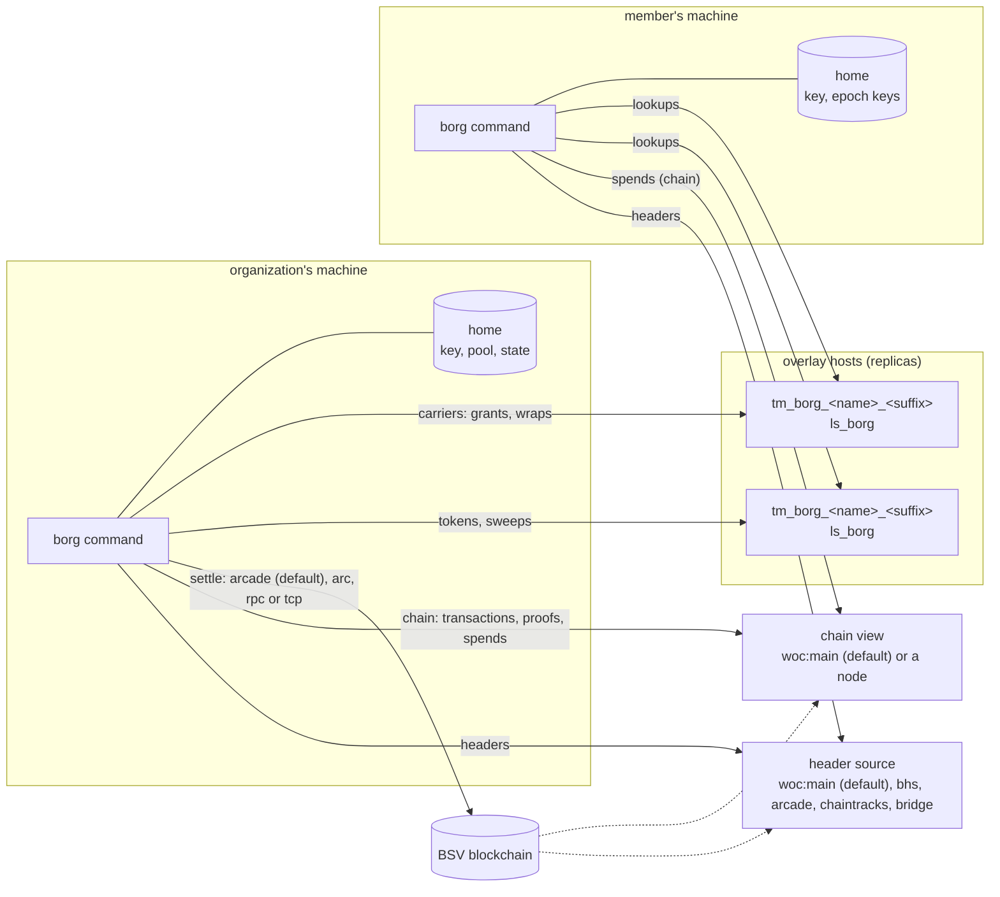

# Architecture

How borg's pieces fit. The byte-level contract is [spec.md](spec.md); what
cannot change once published is [frozen.md](frozen.md).

## The parts

| Part | What it is | Where |
| --- | --- | --- |
| `borg` command | the organization's tooling and the member's client, one static binary | `cmd/borg` |
| home | one identity's directory: `identity.json`, `wallet.json`, `state.json`, mode 0700 | `~/.borg` |
| host module | the topic manager `tm_borg_<hall>` and the lookup service `ls_borg`, loaded by a reference overlay host | `host/` (TypeScript), [host.md](host.md) |
| header source | the block headers every proof is checked against | `header_url` |
| chain view | raw transactions, proofs, and which outputs are spent: WhatsOnChain by default on mainnet and testnet, or a node's asset API | `chain` |
| settlement leg | where mined transactions are broadcast: GorillaPool's public arcade by default on mainnet and testnet | `settle` |
| plane | optional: a multicast plane that delivers one submission to every subscribed host | `mode = plane`, `facade` |
| `devchain` | a local regtest chain for the sandbox and tests; nothing it mines is money | `cmd/devchain` |

## What lives on chain and what lives at the hosts

| Object | Mined? | What it is |
| --- | --- | --- |
| organization token | yes | one per change of the roll: grants admitted and revoked, a Merkle root over the roll |
| group token | yes | one per change of a group: members added and removed, the epoch, the key commitment, a root over the members |
| funding tree | yes | outputs that pay for chains (chain tree) or carry grants and wraps (grant and record trees, 1 sat an output) |
| sweep | yes | spends funding outputs: revokes the grants and retracts the wraps they carried |
| grant carrier | no | a BRC-52 certificate on a funding output; its revocation outpoint is that output |
| wrap carrier | no | an epoch key encrypted to up to 16 members, on a funding output |

Every chain (the organization's, each group's) is a sequence of tokens
where each spends the one before. Two changes made at once spend the same
output and only one is mined, so the chain orders changes with no
coordinator. Carriers are never mined: a host admits one when its funding
output's tree is proven, and retracts it when a mined sweep spends that
output.

## The command's layers

| Layer | Package | Role |
| --- | --- | --- |
| records | `borgrec` (public) | encode, decode and fold every record; the transition rules every host enforces |
| reader | `reader` (public) | ask hosts the `ls_borg` questions, verify every answer against the caller's headers, compare hosts |
| engine | `internal/engine` | build, persist, settle, wait for and publish transitions; wraps; sweeps; catch-up (`org sync`); recovery of interrupted work |
| state | `internal/state` | the home's `state.json`, written atomically, locked one command at a time |
| config | `internal/config` | flags, `BORG_*`, the config file, defaults ([configuration.md](configuration.md)) |
| unicast | `internal/unicast` | submit to each host and count the quorum |
| limits | `internal/limits` | every default and cap ([limits.md](limits.md)) |
| shared | `github.com/lightwebinc/bcommon` | funding trees, carriers, PushDrop, the wallet and pool, header clients, node API, publish legs |

## A change, end to end

1. The command builds the transition in the home, checks it against the
   host rules and the organization's own chain, and **persists it, with
   any epoch key it samples, before anything is sent**.
2. It broadcasts through `settle` and waits until the transaction is mined
   in this home's headers. A transition is given up only on the node's word
   that another transaction spends its input.
3. After `delay` (60 s by default, so the hosts' headers have the block
   too) it publishes the token with its parent to the facade and to every
   host named, and confirms each by a lookup.
4. If the change begins an epoch, it wraps the new key to each remaining
   member in wrap carriers and publishes them.
5. A command that stopped part way finishes all of this first next time.

## A read, end to end

A reader asks every host in `hosts`, verifies each answer (record, lock,
signature, proof against `header_url`), folds the chain itself from seq 0,
and compares hosts: a host that lacks what another answered is reported
(`DISAGREES`), one that answers something that does not verify is named
(`REFUSED`), and verified tokens above the walk are reported (`WITHHELD`).
A host can withhold; it cannot forge.

## Funding

A home holds its own coin. On mainnet and testnet the user sends a payment
from their own wallet to the fund address `init` prints and imports it with
`borg fund -txid`, which reads the transaction and its proof from the
chain view and checks the proof against `header_url`, or hands over the
BEEF its wallet made with `borg fund -beef`, which needs no lookup. No node
is needed. Fees are the network's 100 sat per 1000 bytes with a 100-sat
floor ([limits.md](limits.md#what-it-costs)). `fund` without `-txid` or
`-beef` mines coinbase (coinbase: only on a regtest chain you run, for
development and tests).

## Trust

| You trust | For | Not for |
| --- | --- | --- |
| the header source | which blocks exist | anything a host says |
| the chain view (`chain`: WhatsOnChain by default, or your node) | whether an output is spent now (revocation, writer evidence) | the content of a record, a transaction or a proof: each is checked |
| the broadcaster (`settle`) | taking a transaction to the miners | whether it is valid: its "accepted" is held to the chain view's spends |
| the hosts | availability | integrity: every answer is verified, and roots expose withholding |
| the organization's key | who is a member | nothing else; hosts enforce the transition rules on it too |

What borg does not hide: who belongs to which group and when they joined or
left are public to everyone who reads the hall ([spec.md](spec.md)
section 16).
